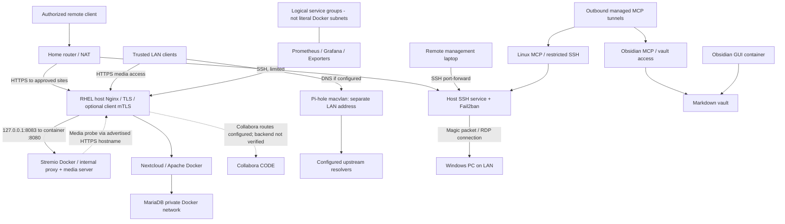
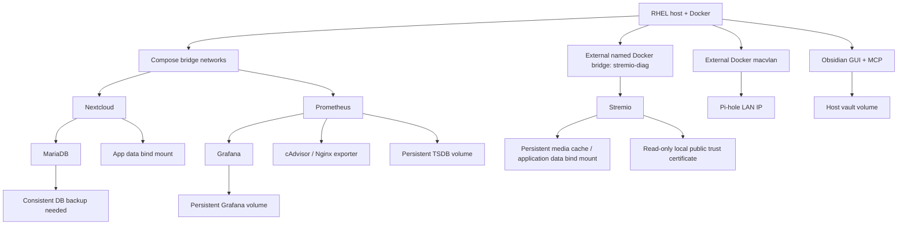

# Sanitized RHEL homelab infrastructure architecture

**Evidence basis:** Obsidian deployment inventory, reverse-proxy, Pi-hole, monitoring, MCP and migration notes recorded in October 2026, plus the documented Stremio deployment and 2026-10-25 recovery. This is a **logical diagram**, not an up-to-the-minute scan. Hostnames, physical addressing, credentials and real network restrictions have been deliberately removed.

## Network, application and trust boundaries

The drawing shows **possible or observed paths**, not proof of public exposure or actual DHCP DNS distribution. Collabora reverse proxy routes existed but a running backend was not verified in the source snapshot.

## Docker / data dependencies

## Stremio service path

Stremio uses the host Nginx HTTPS reverse proxy, which forwards to the loopback-only published port `127.0.0.1:8083` and then container port `8080`. The container's internal proxy reaches Stremio Server on port `11470`; that server port is not published directly on the host.

The sanitized [Compose configuration](../stremio/compose.yaml) attaches Stremio to the separately created `stremio-diag` bridge, persists application/cache data, and mounts a public trust certificate read-only. Media probing also requires the container to resolve and reach its advertised HTTPS hostname through the host proxy. This is a logical dependency, not a claim that Stremio is publicly exposed or protected by client mTLS.

See the [Stremio deployment guide](../stremio/README.md) and [bridge recovery incident](../incidents/stremio-docker-bridge-playback-2026-10-25.md) for implementation details.

## Operational trust boundaries

| Boundary | Verification / concern |
| --- | --- |
| Internet to Nginx | TLS/mTLS varies by virtual host; verify actual enforcement and router reachability |
| Internet to SSH | Prefer public-key auth, restricted allowed users and monitored source traffic |
| Host to Docker | Docker forwarding/NAT can differ from firewalld public-zone listings |
| Container to host | Container localhost is not host localhost; use intentional gateway and SSH policy |
| Stremio to HTTPS proxy | Verify container hostname resolution and certificate trust; loopback publishing does not establish router exposure or client mTLS enforcement |
| LAN to macvlan | Container gets its own LAN IP; host-to-macvlan reachability is special |
| MCP to vault | Write-capable tool needs authenticated access, POSIX permission and SELinux review |
| Monitoring to runtime | cAdvisor mounts and sockets widen read/control capability; isolate accordingly |

## Evidence gaps

The inspected notes did not establish every client DNS assignment, Pi-hole physical macvlan parent, Collabora runtime status, or end-to-end renewal / reboot recovery. An architecture diagram must not be treated as a security scan or as proof of those services' health.

**Related:** [Stremio](../stremio/README.md), [Nextcloud](../nextcloud/README.md), [DNS](../dns/README.md), [Monitoring](../monitoring/README.md), [MCP](../mcp/README.md), [Remote access](../remote-access/README.md), [Security](../security/README.md).
