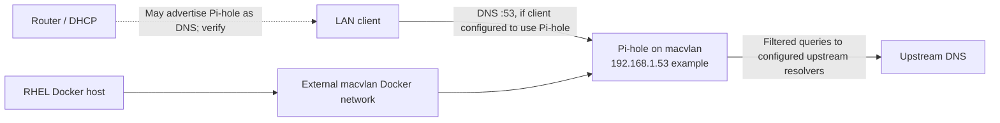

# Pi-hole and LAN DNS on RHEL with Docker macvlan

A sanitized case study based on read-only Obsidian homelab audits from October 2026. The source Pi-hole container was observed **healthy** on an **external Docker macvlan** with its own LAN address. The exact parent NIC and LAN router's client DNS/DHCP assignments were **not verified**.

## Architecture

Pi-hole uses a **separate LAN IP**, not a host `ports:` publish. Its DNS and web interfaces must be protected by LAN rules and administration credentials. Macvlan containers generally cannot reach their parent host directly without additional deliberate network configuration.

## Files
- [compose.yaml](compose.yaml): sanitized example based on inspected Compose.
- [.env.example](.env.example): placeholder IP, timezone, password and Docker network values.
- [macvlan.md](macvlan.md): creation, limitations, migration and validation.
- [operations.md](operations.md): DNS client settings, testing, backups and troubleshooting.

## Source facts vs public example

| Aspect | Read-only source observation | Public documentation |
| --- | --- | --- |
| Platform | RHEL 10.1 and Docker Compose | Same deployment pattern |
| Pi-hole image | `pihole/pihole:latest` | Historical image tag shown; pin a compatible tested version for production |
| Network | Existing `pihole_macvlan` using Docker macvlan | Example `pihole_macvlan` with RFC1918 example LAN |
| Container addressing | Fixed LAN IPv4 on macvlan | `192.168.1.53` example |
| Persistence | Pi-hole config and dnsmasq bind mounts | Relative local paths |
| Listening mode | `FTLCONF_dns_listeningMode: all` | Shown as observed, with access restrictions required |
| Password | Plaintext in original Compose | Read from non-committed `.env` |
| Router DHCP/DNS | Not established | Manual verification checklist |

## Security notes

The historical YAML contained a plaintext Pi-hole web/API password; its value is **never included** here. Rotate any secret previously stored unprotected. Avoid exposing the Pi-hole admin UI or recursive resolver to the public Internet. Ensure clients use Pi-hole only on trusted networks.

Related: [Firewalld](../security/firewalld.md), [SELinux](../security/selinux.md), [Nginx](../nginx/README.md).
