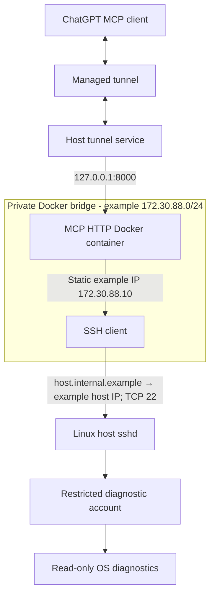
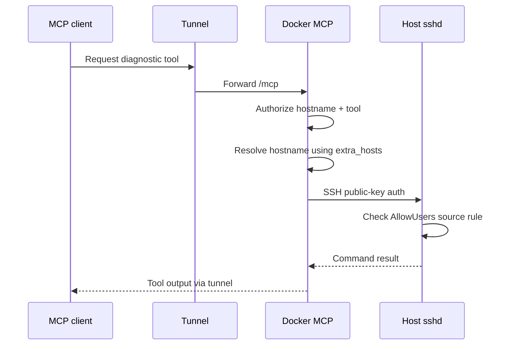

# Linux MCP Docker DNS and SSH source-IP recovery — 2026-10-26

> Sanitized case study. Addresses and hostname below are **examples**, not the private installation's actual values. A successful tool query confirmed service recovery; final narrow source-IP rule and reboot persistence remained pending verification.

## Impact, diagnosis and resolution

A read-only Linux MCP backend continued receiving requests through its managed tunnel, but SSH-based diagnostic tool calls failed. First, the MCP container could not resolve the SSH target's hostname (`getaddrinfo: Name or service not known`). The application policy allowed the hostname, but switching to an IP literal did not match that policy. A temporary hosts-file fix proved the issue; a persistent Docker Compose `extra_hosts` mapping resolved it.

After migrating the manually started container to Compose, SSH failed with `Permission denied`. The host's OpenSSH `AllowUsers` source restriction was scoped to the old default bridge subnet. The new Compose bridge assigned the container a different private source address. Adjusting the allowlist to permit the new source network restored SSH; remote MCP system/CPU/memory tool calls succeeded.

A follow-on attempt to assign a fixed container IP failed because of a malformed CIDR: `172.25.0.0/15` is not an aligned network boundary (that /15 would start at `172.24.0.0`). A correctly aligned /24 was used in the **illustrative config below**; never substitute network prefixes without checking for overlaps. The actual deployment was recovered by correcting its subnet and revalidating remote tools.

## Architecture





## Sanitized Compose example (complete)

Replace illustrative hostname/IPs with your own vetted values; verify local subnet availability. The example uses an SSH key and a separate host-policy file, intentionally excluding contents of either.

```yaml
services:
  lightspeed-mcp:
    image: lightspeed-mcp:latest
    container_name: lightspeed-mcp
    restart: unless-stopped
    user: "1001:1001"
    networks:
      default:
        ipv4_address: 172.30.88.10
    ports:
      - "127.0.0.1:8000:8000"
    extra_hosts:
      - "host.internal.example:192.0.2.10"
    volumes:
      - ./config:/run/mcp-config:ro
      - ./ssh:/run/mcp-ssh:ro
    environment:
      LINUX_MCP_SEARCH_FOR_SSH_KEY: "True"
    command:
      - linux-mcp-server
      - --transport
      - streamable_http
      - --host
      - 0.0.0.0
      - --port
      - "8000"
      - --path
      - /mcp
      - --toolset
      - FIXED
      - --host-mode
      - REMOTE_ONLY
      - --user
      - diagnostic-reader
      - --ssh-key-path
      - /run/mcp-ssh/id_ed25519
      - --known-hosts-path
      - /run/mcp-ssh/known_hosts
      - --verify-host-keys
      - --no-search-for-ssh-key
      - --policy-path
      - /run/mcp-config/policy.yaml
      - --log-level
      - INFO

networks:
  default:
    ipam:
      config:
        - subnet: 172.30.88.0/24
```

**Note:** `192.0.2.10` belongs to the RFC 5737 documentation range and is not a routable target on your LAN. Set `extra_hosts` to your real host's *reachable* IP in the private deployment, and bind the policy to the same hostname.

## Verification and safe SSH tightening

```bash
docker compose config -q
docker network inspect lightspeed-mcp_default --format '{{json .IPAM.Config}}'
docker inspect lightspeed-mcp --format '{{range .NetworkSettings.Networks}}{{.IPAddress}}{{end}}'
docker exec lightspeed-mcp getent hosts host.internal.example
docker logs --tail 50 lightspeed-mcp
sudo sshd -t
sudo journalctl -u sshd --since '15 minutes ago' --no-pager
```

Keep the existing administrator SSH session open. Before applying a narrow allow rule, first confirm the **real source IP** from `sshd` logs, successful authentication, and the current Docker network. Then use a rule such as:

```sshconfig
AllowUsers adminuser diagnostic-reader@172.30.88.10
```

Validate and reload SSH, then retest a diagnostic MCP call. Never delete networks or change SSH authorization blindly during recovery.

## Security considerations and follow-up

- Loopback-bound MCP HTTP means remote LAN clients cannot use the host-published port directly.
- SSH keys remain read-only mounts; host-key verification and the least-privilege account remain enabled.
- Source IP is not a cryptographic container identity. Preserve SSH key authentication and the MCP authorization policy.
- Store raw real addresses, tunnel credentials and SSH material in private operational notes only.
- Verify the chosen static IP after deploy, tighten source allowlist, and perform a reboot-recovery test before declaring hardening complete.
