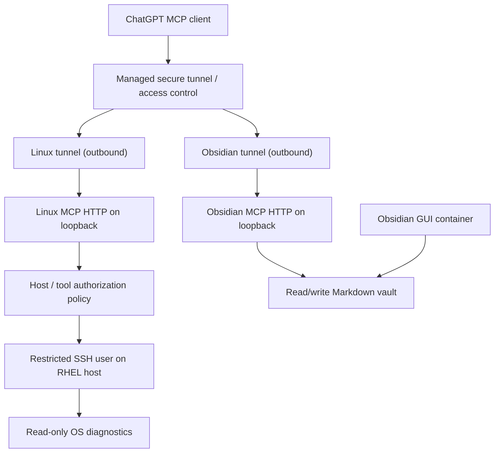

# Self-hosted MCP services on RHEL

These runbooks are sanitized adaptations of October 2026 Obsidian notes. **They document two independent deployed systems**, not an interchangeable generic MCP server.

## Architecture

## Runbooks

- [Linux Lightspeed MCP](linux-lightspeed.md) — build, restricted SSH, policy, streamable HTTP and persistent tunnel.
- [Obsidian MCP](obsidian.md) — TypeScript application, Docker Compose, writable vault, health checks and permissions incident.
- [Operations and hardening](operations.md) — security boundaries, tests, recovery and troubleshooting.

**Observed status:** Linux MCP answered a read-only system-information query and its tunnel service was active in the October 2026 audit. Obsidian MCP read/search and note-writing operations were confirmed. Neither a fresh reboot recovery test nor every end-user authorization scenario was recorded.

## Security boundaries

The Linux MCP host policy in the historic single-operator lab used a permissive `all_users: true` match for a constrained host/tool set. That is **not authentication** and is intentionally **not provided as a production-ready configuration** here. The Obsidian MCP historically published an HTTP port to all host interfaces; the public example below narrows it to loopback, which is a proposed improvement, not an observation of the historical deployment.

No tunnel IDs, API keys, SSH private keys, real IP addresses, usernames, hostnames, vault contents, or production mount paths are published.
