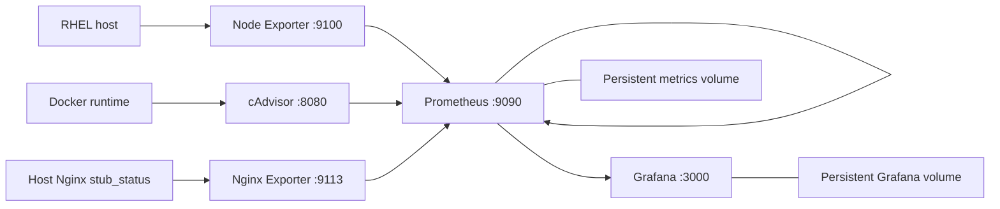

# RHEL monitoring — Prometheus, Grafana and exporters

Sanitized from historical Obsidian audits (17 and 19 October 2026). **The 19 October persistence repair supersedes the earlier Compose snapshot.** The deployment was verified with Grafana persistence, Prometheus history, and container metrics for 11 containers at the time of inspection. These example configurations are **not a byte-for-byte copy** of the current production setup.

## Architecture

## Documents

- [compose.yaml](compose.yaml) — conservative, **illustrative** five-service stack with named volumes
- [prometheus.yml](prometheus.yml) — example scrape jobs: node, cAdvisor, Nginx and Prometheus
- [operations.md](operations.md) — diagnostics, dashboards, PromQL and security
- [backup-recovery.md](backup-recovery.md) — persistence repair, backups, migration and rollback

## Verified source observations

- Prometheus mapped host port 9091 to 9090 and scraped on a 5-second interval.
- Grafana hosted on port 3000. An initial snapshot showed **no persistent volume**; later work moved it to an explicitly declared external volume and a recreated Grafana retained its admin login.
- Prometheus retained its existing TSDB volume and historical data; self-scrape was added.
- cAdvisor was subsequently given host and runtime mounts. Per-container metrics were verified after that change.
- Nginx Exporter read host Nginx `stub_status` through a gateway address; it does not provide response-code or latency histograms by itself.
- Node Exporter ran on the host network. Its filesystem coverage was not fully verified; PSI pressure metrics were unavailable on the inspected host and an I/O wait panel was used instead.
- Five dashboards were recorded; they are **not included here as full exports**, since the local export archive was not fetched.

The actual original service tags were unpinned. Test version compatibility and replace sample tags with **explicit supported tags or digests** in a real installation.

## Security

Do not directly expose Grafana, Prometheus, cAdvisor, Nginx Exporter or runtime sockets to untrusted networks. Restrict host stub_status to approved scraper clients. cAdvisor's Docker/containerd sockets are powerful interfaces even if bind-mounted read-only; the example does **not** enable full privileged container monitoring by default.
