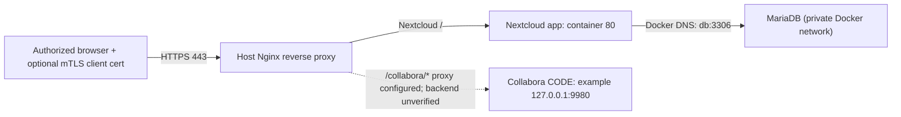

# Nextcloud + MariaDB + Collabora integration on RHEL

Sanitized case study based on Obsidian deployment audits captured in October 2026. **Do not confuse an observed configuration with a verified fully operational stack**: Nextcloud and MariaDB Compose were captured, while Collabora proxy routing existed but its running container and Compose configuration were not verified.

## Architecture

The observed reference deployment used RHEL 10.1 with Docker Compose, Nextcloud's Apache-based image, MariaDB 10.6, host-level Nginx and client-certificate verification. The actual DB was **not** published to the host; Nextcloud reached it via Compose service name `db`.

## Contents

- [Sanitized Compose example](compose.yaml) — illustrates the observed Nextcloud/MariaDB layout but **does not contain original credentials or host filesystem paths**.
- [Operations and recovery](operations.md) — validation, updates, consistent backup and restoration.
- [Collabora integration](collabora.md) — observed Nginx routes, sample reverse-proxy patterns and backend verification gaps.

- [Hourly CPU watchdog](cpu-watchdog.md) — conditional recovery for rare CPU saturation, full script and systemd units, thresholds, evidence and limitations.

## Deploying on a separate test host

1. Prepare Docker, Docker Compose and suitable persistent storage. Set SELinux mount labels appropriately; the example uses dedicated local paths with `:Z`.
2. Copy `.env.example` to `.env`, generate two **different**, strong passwords for database root and Nextcloud database account, and keep `.env` out of Git.
3. Review image versions and pin a tested, maintained release. The historical source used `mariadb:10.6` and an unpinned `nextcloud` image; that is a **record**, not advice to use those versions today.
4. Run `docker compose config` and `docker compose up -d`.
5. Connect through a correctly configured HTTPS reverse proxy; set Nextcloud's `trusted_domains`, `trusted_proxies` and forwarded HTTPS settings according to its documentation.
6. Validate application login, background jobs, uploads, DB connectivity, log health, restores, and optionally Collabora editing.

**Note:** variables used for database initialization only take effect when creating a new DB volume. Editing an environment variable does not rotate the credentials in an existing database.

## Security boundary

Public repo files deliberately omit the real hostname, external IP, machine name, router layout, exact production mount locations, passwords, keys, client certificates, and browser state. The observed source had identical database root and application passwords stored inline in Compose; this is flagged as a security concern, not reproduced.

## Related projects

- [Nginx, Certbot and mTLS](../nginx/README.md)
- [SELinux](../security/selinux.md)
- [Firewalld](../security/firewalld.md)
