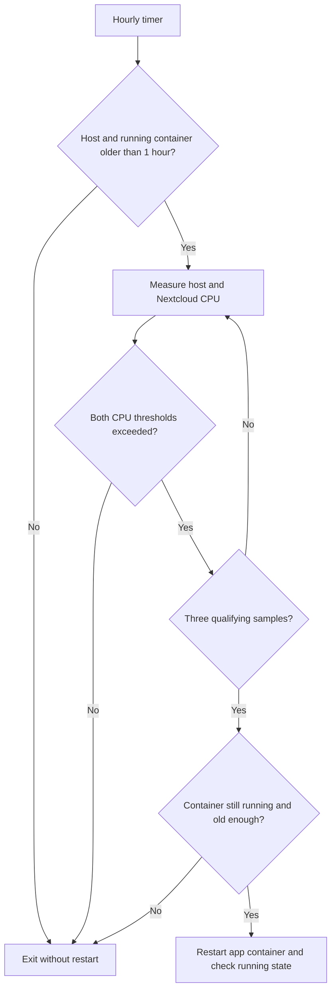

# Nextcloud CPU watchdog — hourly conditional recovery

Recorded: 26 October 2026. The deployed Python script and both systemd unit files were read back from the server. The initial healthy check is evidenced by the user's journal screenshot. This is an operational workaround, not a confirmed root-cause fix.

## Why we added this

Rare CPU saturation episodes were attributed to Apache/PHP workers inside the Nextcloud application container. In the 12 October investigation:

- Docker reported approximately 597.11% CPU, equivalent to almost six logical CPUs, with only about 213 MiB of container RAM.
- Several Apache workers accumulated 26–43 minutes of CPU time.
- Short strace samples captured no system calls, consistent with CPU-bound user-space work.
- perf samples were predominantly associated with JIT-generated code. PHP CLI inspection showed OPcache JIT enabled; CLI settings alone do not establish the Apache runtime configuration.
- The workload appeared to subside without restarting, based on fan noise; CPU was not remeasured at that exact moment.

**The exact trigger remains unconfirmed.** Neither an infinite loop nor a PHP JIT defect was proven. Separate automated Nginx probing was observed, but no causal link to the CPU spike was established.

On 26 October, the operator reported rare recurrence and wanted automatic recovery without logging in each time. Restarting replaces the app container's busy processes and may clear the symptom. The policy therefore restarts only when host saturation coincides with substantial Nextcloud CPU usage, and only after startup grace periods.

## Components and installed paths

| Component | Installed path | Role |
|---|---|---|
| Python script | /usr/local/bin/nextcloud-cpu-watchdog | Measure CPU, apply guards, conditionally restart |
| One-shot service | /etc/systemd/system/nextcloud-cpu-watchdog.service | Run the script as a managed job |
| Timer | /etc/systemd/system/nextcloud-cpu-watchdog.timer | Activate the job about once per hour |

The job runs on the Docker host, not inside Nextcloud. Python uses only the standard library; Docker CLI and daemon access are required. The current timestamp parser requires a compatible Python version (Python 3.11+ recommended for the Docker ISO timestamp format).

## Decision policy

All comparisons below are strict: equality does not qualify for restart.

| Condition | Required value |
|---|---|
| Linux host uptime from /proc/uptime | Greater than 3,600 seconds |
| Nextcloud state | Running |
| Container age from Docker StartedAt | Greater than 3,600 seconds |
| Host CPU busy percentage | Greater than 80% |
| Nextcloud share of total host CPU capacity | Greater than 50% |
| CPU confirmations | Both thresholds exceeded in all 3 samples |

Each sample waits 10 seconds and then invokes Docker stats. Three qualifying samples therefore take roughly 30 seconds plus command overhead. Any nonqualifying sample exits immediately without restarting. Container age is checked again before restarting to avoid acting on a container restarted during sampling.



### CPU calculations

Docker CPU percentage uses approximately 100% per fully utilized logical CPU. The script divides that value by os.cpu_count() to express Nextcloud usage as a share of total server capacity.

For an example six-logical-CPU host, Docker 300% equals 50% of server capacity; the strict threshold requires more than 300%. Docker 597% would be about 99.5%. This is an example, not a new hardware inventory assertion.

Host usage is computed from changes in /proc/stat: busy = 100 × (1 − delta idle / delta total). The implementation treats idle plus iowait as idle and excludes duplicate guest counters from total.

Host CPU is averaged over the sleep plus Docker call. Docker stats supplies its own shorter measurement window; this is repeated confirmation, not proof that both values remained continuously high for the entire interval. It measures CPU utilization, not Linux load average.

## Python implementation

The following mirrors the installed script read back on 26 October, with the container name replaced by `nextcloud-app`. Set CONTAINER to your actual application container name before installing.

```python
#!/usr/bin/env python3

import datetime
import json
import os
import subprocess
import time

CONTAINER = "nextcloud-app"
MIN_UPTIME = 3600
HOST_CPU_THRESHOLD = 80.0
NEXTCLOUD_CAPACITY_THRESHOLD = 50.0
SAMPLES = 3
INTERVAL = 10


def log(message):
    print(message, flush=True)


def docker(*args):
    result = subprocess.run(
        ["docker", *args],
        check=True,
        capture_output=True,
        text=True,
        timeout=60,
    )
    return result.stdout.strip()


def cpu_counters():
    with open("/proc/stat") as handle:
        values = [int(value) for value in handle.readline().split()[1:]]
    # Guest time is already included in user/nice time.
    total = sum(values[:8])
    idle = values[3] + values[4]
    return total, idle


def container_old_enough():
    info = json.loads(docker("inspect", CONTAINER))[0]
    state = info["State"]

    if not state["Running"]:
        log("Skipped: Nextcloud is not running.")
        return False

    started = datetime.datetime.fromisoformat(
        state["StartedAt"].replace("Z", "+00:00")
    )
    age = (
        datetime.datetime.now(datetime.timezone.utc) - started
    ).total_seconds()

    if age <= MIN_UPTIME:
        log("Skipped: Nextcloud uptime is one hour or less.")
        return False

    return True


def main():
    with open("/proc/uptime") as handle:
        uptime = float(handle.read().split()[0])

    if uptime <= MIN_UPTIME:
        log("Skipped: server uptime is one hour or less.")
        return

    if not container_old_enough():
        return

    cores = os.cpu_count() or 1

    for sample in range(1, SAMPLES + 1):
        total_before, idle_before = cpu_counters()
        time.sleep(INTERVAL)

        raw_cpu = docker(
            "stats", "--no-stream", "--format", "{{.CPUPerc}}", CONTAINER
        )
        container_cpu = float(raw_cpu.rstrip("%"))

        total_after, idle_after = cpu_counters()
        delta = total_after - total_before
        if delta <= 0:
            raise RuntimeError("Invalid host CPU sample; no restart performed.")

        host_cpu = 100.0 * (
            1.0 - (idle_after - idle_before) / delta
        )
        capacity_cpu = container_cpu / cores

        log(
            f"Sample {sample}/{SAMPLES}: host={host_cpu:.1f}%, "
            f"Nextcloud={container_cpu:.1f}% Docker CPU "
            f"({capacity_cpu:.1f}% of server capacity)"
        )

        if (
            host_cpu <= HOST_CPU_THRESHOLD
            or capacity_cpu <= NEXTCLOUD_CAPACITY_THRESHOLD
        ):
            log("No restart: CPU conditions are not both met.")
            return

    # Recheck in case the container restarted during sampling.
    if not container_old_enough():
        return

    log("Sustained high CPU detected. Restarting Nextcloud.")
    docker("restart", "--timeout", "30", CONTAINER)

    running = docker("inspect", "--format", "{{.State.Running}}", CONTAINER)
    if running != "true":
        raise RuntimeError("Nextcloud is not running after restart.")

    log("Nextcloud restarted. Container is running; app readiness not checked.")


if __name__ == "__main__":
    try:
        main()
    except Exception as exc:
        log(f"ERROR: {exc}")
        raise SystemExit(1)
```

Function responsibilities:

- log(): flushes messages immediately into the service journal.
- docker(): invokes Docker without a shell, captures output, checks exit status, and limits each call to 60 seconds.
- cpu_counters(): reads host-wide CPU counters.
- container_old_enough(): checks running state and startup age; stopped containers are skipped rather than started.
- main(): applies uptime guards, gathers samples, exits on low usage, rechecks age, and restarts only after all confirmations.
- Exception handling: reports ERROR and exits nonzero. A collection/parsing failure does not intentionally trigger recovery. If an error occurs during or after the restart call, the restart may already have happened; inspect container state.

The action is docker restart --timeout 30 on the app container only. Docker allows up to 30 seconds for graceful stop before forced termination, then starts the existing container. It does not recreate the container, delete volumes, or restart the database. Active uploads, requests, and background jobs may be interrupted.

## systemd service

```ini
[Unit]
Description=Restart Nextcloud only after sustained high CPU usage
After=docker.service

[Service]
Type=oneshot
ExecStart=/usr/local/bin/nextcloud-cpu-watchdog
TimeoutStartSec=180
StandardOutput=journal
StandardError=journal
```

| Directive | Explanation |
|---|---|
| After=docker.service | Orders startup after Docker when both jobs are queued; does not itself start Docker or guarantee daemon health |
| Type=oneshot | Runs the script once, then exits |
| ExecStart | Absolute path of the installed executable |
| TimeoutStartSec=180 | Caps the overall service activation at three minutes |
| StandardOutput / StandardError=journal | Sends output and errors to journald |

No User= is set, so this system service runs as root and can access Docker. The script should be root-owned and not writable by untrusted users. No RemainAfterExit is set: after success, inactive/dead and “Deactivated successfully” are expected. The timer remains active. Systemd does not start a second instance of this same service while it is already active.

## systemd timer

```ini
[Unit]
Description=Check Nextcloud CPU usage every hour

[Timer]
OnBootSec=1h
OnUnitActiveSec=1h
AccuracySec=1min
Unit=nextcloud-cpu-watchdog.service

[Install]
WantedBy=timers.target
```

| Directive | Explanation |
|---|---|
| OnBootSec=1h | First activation around one hour after boot; may fire immediately when enabled after that point |
| OnUnitActiveSec=1h | Subsequent activation about one hour after the service was last activated |
| AccuracySec=1min | Allows systemd to coalesce the event within a one-minute accuracy window |
| Unit= | Selects the service to activate |
| WantedBy=timers.target | Allows enable to schedule the timer on future boots |

This is a monotonic interval timer, not a wall-clock “at minute zero” schedule. Exactly one hour of uptime still fails the strict script guard; a first check at that boundary can skip until the next activation. Missed runs while the machine is powered off are not replayed; after boot the startup grace period applies again.

The hourly timer controls when checks occur; it does not mean CPU must have been high for an hour. A spike can last nearly an hour before the next check, and shorter spikes between checks can be missed.

## Installation and activation

Repository copies: [script](watchdog/nextcloud-cpu-watchdog), [service](watchdog/nextcloud-cpu-watchdog.service), [timer](watchdog/nextcloud-cpu-watchdog.timer). The public container name is a placeholder, not the original deployment identifier.

Save the complete script and unit contents above to their corresponding paths. Then run:

```bash
sudo chown root:root /usr/local/bin/nextcloud-cpu-watchdog
sudo chmod 755 /usr/local/bin/nextcloud-cpu-watchdog
sudo chmod 644 /etc/systemd/system/nextcloud-cpu-watchdog.service
sudo chmod 644 /etc/systemd/system/nextcloud-cpu-watchdog.timer
sudo systemctl daemon-reload
sudo systemctl enable --now nextcloud-cpu-watchdog.timer
sudo systemctl list-timers nextcloud-cpu-watchdog.timer
```

Enable the timer, not the one-shot service. Enabling on a host already up for more than one hour can start a check immediately.

## Validation observed

On 26 October, the supplied journal showed:

```text
Sample 1/3: host=3.8%, Nextcloud=0.0% Docker CPU (0.0% of server capacity)
No restart: CPU conditions are not both met.
Deactivated successfully.
Finished nextcloud-cpu-watchdog.service.
```

This verifies the real low-CPU exit path and normal one-shot completion. It does not verify recovery under saturation, application readiness after restart, or future timer execution. No artificial CPU stress or forced container restart was performed for this documentation.

## Operations

Read-only checks:

```bash
sudo systemctl is-enabled nextcloud-cpu-watchdog.timer
sudo systemctl status nextcloud-cpu-watchdog.timer --no-pager
sudo systemctl list-timers --all nextcloud-cpu-watchdog.timer
sudo journalctl -u nextcloud-cpu-watchdog.service -n 50 --no-pager
sudo journalctl -u nextcloud-cpu-watchdog.service --since today --no-pager
```

To run the real check manually (this can restart Nextcloud if thresholds are met):

```bash
sudo systemctl start nextcloud-cpu-watchdog.service
```

To change thresholds, edit the constants at the top of the script. The next invocation reads the updated script; no daemon reload is needed for script-only changes. For unit changes, use daemon-reload; after timer changes, restart the timer and inspect its next trigger.

Pause future automatic checks:

```bash
sudo systemctl disable --now nextcloud-cpu-watchdog.timer
```

Stopping the timer does not cancel an already-running service. Inspect its status if maintenance is in progress; stopping it cannot undo a restart already issued.

## Limits and follow-up

- This mitigates a symptom and does not establish the reason for the CPU spike.
- Legitimate indexing, previews, sync, or other heavy PHP work can meet the thresholds. Pause the timer during planned maintenance or heavy jobs where interruption is unacceptable.
- There is no maintenance-mode detection, alert delivery, diagnostic snapshot, or daily restart limit.
- Container age provides a cooldown, but persistent recurrence can still cause repeated restarts on later checks.
- The post-restart check confirms only Docker's running state, not Nextcloud HTTP, database, or login readiness.
- The host-capacity calculation assumes the script runs on the host. Reassess CPU quotas/cpusets or containerized watchdog execution before reuse.
- Journal retention follows the host journald configuration; no separate log rotation or persistent journal setup was added.
- Docker calls have individual timeouts, while systemd caps the whole job at 180 seconds. A hung command can cause service failure; inspect the journal rather than assuming recovery.
- During a future recurrence, correlate requests, PHP workers and background jobs. A controlled JIT-off comparison remains an investigative option, not a proven fix.

## Related incident

[October CPU investigation](../incidents/nextcloud-cpu-nginx-2026-10.md)

## Redaction

Host identifiers, usernames, addresses, credentials and original container identifiers are omitted. Only the container name differs between the public script and the private deployed copy.
