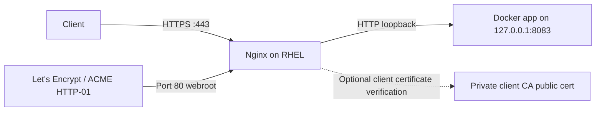

# Nginx reverse proxy, Certbot and optional mTLS on RHEL

This guide is a **sanitized adaptation** of a real RHEL 10.1 homelab runbook. Real service domains, backend ports, private keys, certificate serials, users and internal topologies have been omitted or replaced with examples.

## Architecture



Use `app.example.com` below as a placeholder. For actual Let's Encrypt certificates use a real hostname you control; reserved `example.com` names are **not issuable** to you.

## Install and plan

- Install supported Nginx and Certbot packages for your RHEL release through trusted repositories.
- Create the ACME webroot: `sudo install -d -m 755 /var/www/certbot/.well-known/acme-challenge`.
- Point real DNS to the host, and allow/forward port 80 for an HTTP-01 challenge where applicable. If port 80 cannot be reachable from the public Internet, consider a compatible DNS-01 challenge instead.
- For containerized apps, bind backend ports to `127.0.0.1` when only the host reverse proxy should access them.

## Example HTTPS reverse proxy

The following is **illustrative** and assumes a valid certificate has already been issued. Do not deploy it before replacing the hostname and certificate paths:

```nginx
server {
    listen 80;
    server_name app.example.com;

    location ^~ /.well-known/acme-challenge/ {
        root /var/www/certbot;
        default_type text/plain;
    }

    location / {
        return 301 https://$host$request_uri;
    }
}

server {
    listen 443 ssl;
    server_name app.example.com;

    ssl_certificate     /etc/letsencrypt/live/app.example.com/fullchain.pem;
    ssl_certificate_key /etc/letsencrypt/live/app.example.com/privkey.pem;

    location / {
        proxy_pass http://127.0.0.1:8083;
        proxy_http_version 1.1;
        proxy_set_header Host $host;
        proxy_set_header X-Real-IP $remote_addr;
        proxy_set_header X-Forwarded-For $proxy_add_x_forwarded_for;
        proxy_set_header X-Forwarded-Proto $scheme;
    }
}
```

For WebSocket apps add and test correct `Upgrade`/`Connection` handling. For applications handling large uploads or long-lived streams, review buffering and timeouts individually rather than blindly disabling all proxy buffering.

## Certbot example

```bash
# Replace with a genuine domain you own and have routed correctly.
sudo certbot certonly --webroot -w /var/www/certbot -d app.your-owned-domain.example
sudo certbot certificates
sudo certbot renew --dry-run
sudo systemctl list-timers --all | grep -i certbot
sudo nginx -t
sudo systemctl reload nginx
```

**Warning:** `app.your-owned-domain.example` is a placeholder, not a DNS-valid public name; replace it before running Certbot.

A certbot renewal timer being active does **not** prove a certificate was renewed or Nginx reloaded it. Verify actual certificate dates and the renewal deploy-hook behavior. If you add a deploy hook to reload Nginx, have it validate `nginx -t` first.

## Optional mutual TLS

For a sensitive service, Nginx can require a certificate issued by a trusted **client CA**:

```nginx
# Inside the relevant HTTPS server block only:
ssl_client_certificate /etc/nginx/mtls/clients-ca.crt;
ssl_verify_client on;
ssl_verify_depth 2;
```

Keep the **client CA private key and clients' private keys** offline or in an approved encrypted secrets store. Only the public CA certificate belongs on the reverse proxy. mTLS does not eliminate the need for patching, app authentication/authorization, and proper network restrictions.

## Operational checks

```bash
sudo nginx -t
sudo systemctl status nginx --no-pager
sudo ss -lntp | grep -E ':(80|443)[[:space:]]'
sudo certbot certificates
sudo certbot renew --dry-run
sudo journalctl -u nginx -n 100 --no-pager
curl -I https://app.example.com/
```

Use a real hostname for the last test. A loopback `curl` is not proof of WAN accessibility. Avoid publishing `nginx -T` output without reviewing it for domain and access-control details.

## Backup and rollback

Back up Nginx configurations and certificate/ACME state **encrypted** on a trusted system. Preserve the `/etc/letsencrypt/live` symlinks to `archive` when restoring. Never commit `/etc/letsencrypt`, `/etc/nginx/mtls`, private keys, browser certificates, or authentication hashes to GitHub. Stage a replacement config, run `nginx -t` and only then reload. Retain a tested rollback and local console access.

## Related
- [Firewalld](../security/firewalld.md)
- [SELinux](../security/selinux.md)
- [Stremio deployment example](../stremio/README.md)
- [Nginx documentation](https://nginx.org/en/docs/)
- [Certbot documentation](https://eff-certbot.readthedocs.io/)
