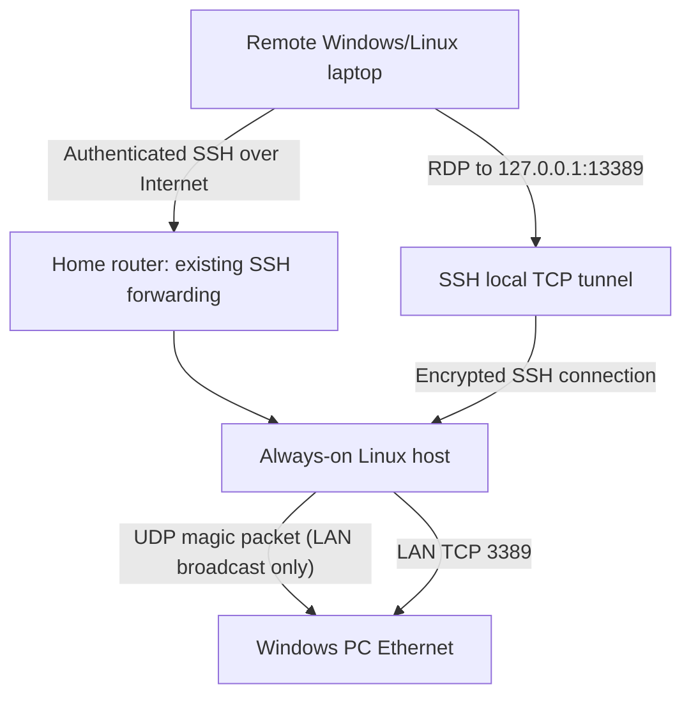

# Wake-on-LAN and secure Windows RDP through a Linux jump host

This lab documents remote access to a Windows machine on a home LAN via an always-on RHEL server. It is adapted from private Obsidian notes; all names and addresses below are **examples**.

> Observed in the lab: remotely initiating Wake-on-LAN and then connecting via SSH-forwarded RDP was reported working. Sleep versus full shutdown (S5), reboot persistence and individual command variants have not all been independently verified.

## Network architecture

**No public forwarding of RDP TCP/3389 or Wake-on-LAN UDP/9 is needed.** Only an existing, securely managed SSH access path to Linux is used.

## Prerequisites

- RHEL/Linux server running on the same LAN/broadcast domain as the Windows machine.
- SSH access to Linux via a controlled public endpoint, preferably key authentication and Fail2ban.
- Windows with wired Ethernet NIC and BIOS/UEFI supporting WoL; compatible power state and a powered NIC.
- Windows Pro/Enterprise/Education or other RDP-host-capable edition, with Remote Desktop enabled and Windows Firewall limited appropriately.
- IP reservation for the Windows machine is recommended.

## Setup and verification

See [wake-on-lan.md](wake-on-lan.md) for BIOS, Windows powercfg, packets, and remote wake; [ssh-rdp.md](ssh-rdp.md) for the end-to-end SSH forwarding and Windows Remote Desktop procedure.

## Security

- Do **not** expose port 3389 or UDP port 9 to the public Internet.
- Use authenticated SSH with key management, host-key validation, an appropriate restricted account and firewall allow rules.
- Ensure Windows requires Network Level Authentication when supported, uses strong credentials, and receives security updates.
- Limit SSH forwarding to the intended destination/account where practical; never use unrestricted public bastion credentials for casual scripts.
- A magic packet is **not authenticated**. Remote authorization here is enforced by SSH, not WoL.

## Incident/test checklist

- [ ] Wired WoL supported and enabled in BIOS and NIC
- [ ] Wake from sleep verified locally
- [ ] Optional wake from S5 tested separately
- [ ] Wake from external network through SSH verified
- [ ] Windows RDP responds from Linux on TCP 3389
- [ ] SSH local port-forward active and bound to 127.0.0.1
- [ ] RDP connection works using localhost:13389
- [ ] No WAN-exposed 3389/UDP9
- [ ] Logs and credentials sanitized before public sharing

Related: [RHEL security](../security/README.md), [Firewalld](../security/firewalld.md), [Fail2ban](../security/fail2ban.md).
